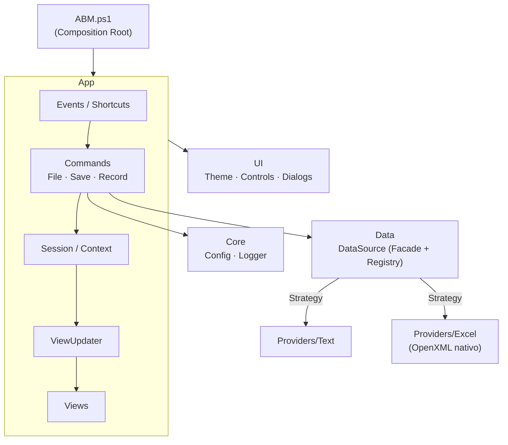

# ABM de Datos · Excel & TXT

Aplicación de escritorio en **PowerShell** para dar de **A**lta, **B**aja y **M**odificar registros en libros de Excel (`.xlsx` / `.xlsm`) y archivos de texto (`.txt`), con una interfaz de estilo ejecutivo.

Está pensada para **entornos corporativos donde no se puede instalar nada**: usa solo lo que Windows ya trae.


---

## ✨ Características

**100 % nativo**
- Windows PowerShell 5.1 + .NET Framework (WinForms, System.Data, System.IO.Compression).
- **No necesita Excel instalado**: lee y escribe el formato OpenXML (ZIP + XML) directamente.
- No instala módulos, no genera `.exe`, no usa `.bat` ni compila código C#.

**Excel (`.xlsx` / `.xlsm`)**
- Detecta automáticamente la fila de encabezados, aunque haya títulos o subtítulos arriba.
- Al guardar **conserva** los estilos de cada columna, las filas de título, los anchos, los paneles inmovilizados, el autofiltro, las tablas de Excel y el resto de las hojas.
- Reconoce fechas, números, booleanos (`VERDADERO` / `FALSO`) y textos con formato.
- Respeta los códigos con ceros a la izquierda (`007` sigue siendo texto).
- Selector de hoja para libros con varias hojas.

**Texto (`.txt`)**
- Detecta automáticamente el delimitador: `;`, tabulación, `|` o `,`.
- Detecta la codificación (UTF-8 con o sin BOM, UTF-16 o ANSI) y la mantiene al guardar.
- Soporta campos entre comillas con delimitadores o comillas dentro (`"Tornillo; largo"`).
- Si no hay delimitador, trabaja en **modo texto plano**: cada línea es un registro.

**Interfaz**
- Encabezado corporativo, tarjetas de indicadores (registros, columnas, origen y estado) y grilla con filas alternadas.
- Búsqueda instantánea sobre todas las columnas y ordenamiento por columna.
- Arrastrar y soltar archivos sobre la ventana.
- **Nuevo archivo**: creás un Excel o un TXT definiendo sus columnas.
- **Guardar como**: convierte de Excel a TXT y viceversa.
- Aviso de cambios sin guardar al cerrar, cambiar de hoja o abrir otro archivo.

**Trazabilidad**
- Auditoría de cada operación (abrir, alta, baja, modificación, guardar) en `Logs\auditoria_yyyyMM.txt`, con fecha, hora y usuario de Windows.
- Respaldo automático del archivo antes de cada guardado en `Backups\`, con rotación configurable.

---

## 🚀 Uso

```powershell
git clone https://github.com/Brunitoa10/lector_excel.git
cd lector_excel

.\ABM.ps1                              # abre la aplicación vacía
.\ABM.ps1 -Path .\inventario.xlsx      # abre directamente un archivo
```

Si la política de ejecución bloquea el script, desbloqueá los archivos descargados:

```powershell
Get-ChildItem -Recurse | Unblock-File
```

### Requisitos

| Requisito        | Versión                              |
|------------------|--------------------------------------|
| Sistema operativo | Windows 10 / 11                     |
| PowerShell       | Windows PowerShell 5.1 (viene con Windows) |
| .NET Framework   | 4.5 o superior (viene con Windows)    |
| Microsoft Excel  | **No requerido**                      |

---

## ⌨️ Atajos de teclado

| Atajo            | Acción                                  |
|------------------|-----------------------------------------|
| `Ctrl + O`       | Abrir archivo                           |
| `Ctrl + N`       | Alta de registro                        |
| `F2` / doble clic | Modificar el registro seleccionado     |
| `Supr`           | Baja de los registros seleccionados     |
| `Ctrl + S`       | Guardar                                 |
| `Ctrl + Shift + S` | Guardar como (Excel o TXT)            |
| `Ctrl + F`       | Ir a la búsqueda                        |
| `Esc`            | Limpiar la búsqueda                     |
| `F5`             | Recargar el archivo desde el disco      |

---

## ⚙️ Configuración

El archivo `config.json` es opcional; si falta o tiene errores, se usan los valores por defecto.

```json
{
  "Auditoria": true,
  "Backup": true,
  "MaxBackupsPorArchivo": 10,
  "CarpetaLogs": "Logs",
  "CarpetaBackups": "Backups",
  "DelimitadorTxtPorDefecto": ";"
}
```

| Clave                      | Descripción                                                          |
|----------------------------|----------------------------------------------------------------------|
| `Auditoria`                | Registra cada operación en `Logs\auditoria_yyyyMM.txt`.              |
| `Backup`                   | Copia el archivo a `Backups\` antes de sobrescribirlo.               |
| `MaxBackupsPorArchivo`     | Cantidad de respaldos que se conservan por archivo.                 |
| `CarpetaLogs` / `CarpetaBackups` | Carpetas relativas a la ubicación de `ABM.ps1`.                |
| `DelimitadorTxtPorDefecto` | Delimitador para TXT nuevos: `;`, `\|`, `,` o `tab`.                 |

Ejemplo de línea de auditoría:

```
2026-11-04 10:15:42 | MODIFICACION | bparisi         | inventario.xlsx [Equipos] | Sector: 'Planta' → 'Sistemas'
```

---

## 🏗️ Arquitectura

El código está organizado **en capas, una carpeta por capa**, con **un módulo `.psm1` por responsabilidad** (ninguno supera las ~190 líneas). Aplica principios **SOLID**, patrones de diseño y prácticas de **clean code**: funciones cortas, nombres descriptivos, sin valores mágicos y sin estado global fuera del contexto de la aplicación.

```
lector_excel/
├── ABM.ps1                         # Punto de entrada: carga módulos, configura y arranca (Composition Root)
├── config.json                     # Configuración opcional
├── Core/                           # Transversal
│   ├── ABM.Config.psm1             #   Configuración con valores por defecto
│   └── ABM.Logger.psm1             #   Auditoría en .txt y respaldos con rotación
├── Data/                           # Modelo y acceso a datos
│   ├── ABM.DataTable.psm1          #   Tabla en memoria, nombres únicos, registro <-> texto
│   └── ABM.DataSource.psm1         #   Fachada + registro de estrategias
├── Providers/                      # Estrategias por formato de archivo
│   ├── ABM.ProviderSetup.psm1      #   Registro de los formatos incluidos
│   ├── Text/
│   │   ├── ABM.TextEncoding.psm1   #     Detección de codificación (BOM, UTF-8, ANSI)
│   │   ├── ABM.DelimitedText.psm1  #     Delimitador, comillas y escape de campos
│   │   └── ABM.TextProvider.psm1   #     Estrategia .txt
│   └── Excel/
│       ├── ABM.OpenXmlPackage.psm1 #     ZIP, partes XML, relaciones y estructura del libro
│       ├── ABM.CellAddress.psm1    #     Letras de columna <-> índice
│       ├── ABM.CellValue.psm1      #     Números, fechas y booleanos (lectura y escritura)
│       ├── ABM.ExcelStyles.psm1    #     Estilos con formato de fecha
│       ├── ABM.ExcelReader.psm1    #     Hoja -> tabla (detección de encabezado)
│       ├── ABM.ExcelWriter.psm1    #     Tabla -> hoja (conservando estilos por columna)
│       ├── ABM.ExcelMaintenance.psm1 #   Rangos, tabla de Excel y cadena de cálculo
│       ├── ABM.ExcelTemplate.psm1  #     Libro nuevo con estilo corporativo
│       └── ABM.ExcelProvider.psm1  #     Estrategia .xlsx / .xlsm (orquesta lo anterior)
├── UI/                             # Componentes visuales reutilizables
│   ├── ABM.Theme.psm1              #   Paleta, tipografías y escala DPI
│   ├── ABM.Controls.psm1           #   Fábrica de paneles, etiquetas y botones
│   ├── ABM.KpiCard.psm1            #   Tarjeta de indicador
│   ├── ABM.GridStyle.psm1          #   Estilo de la grilla
│   └── Dialogs/
│       ├── ABM.Messages.psm1       #     Mensajes y confirmaciones
│       ├── ABM.DialogShell.psm1    #     Armazón común de diálogos
│       ├── ABM.RecordDialog.psm1   #     Alta / modificación
│       └── ABM.NewFileDialog.psm1  #     Nuevo archivo
├── App/                            # Aplicación
│   ├── ABM.AppContext.psm1         #   Estado de la sesión y registro de controles
│   ├── ABM.Session.psm1            #   Transiciones de estado y consultas
│   ├── ABM.ViewUpdater.psm1        #   Refresco de la vista a partir del estado
│   ├── ABM.SearchFilter.psm1       #   Búsqueda sobre todas las columnas
│   ├── ABM.Shortcuts.psm1          #   Atajos de teclado definidos como datos
│   ├── ABM.Events.psm1             #   Conexión de eventos con comandos
│   ├── ABM.MainForm.psm1           #   Ventana principal (sólo composición)
│   ├── Views/                      #   Encabezado, barra de acciones, indicadores, grilla y estado
│   └── Commands/                   #   Comandos de archivo, de guardado y de registros (ABM)
└── Tests/
    └── Test-Providers.ps1          # Pruebas automáticas de la capa de datos
```



### Patrones y principios aplicados

| Patrón / principio | Dónde se aplica |
|--------------------|-----------------|
| **Strategy**       | Cada formato de archivo implementa `Read`, `Save` y `Create` (`Providers/`). |
| **Registry**       | `Register-AbmProvider` asocia extensiones con estrategias. |
| **Facade**         | `Open-AbmSource`, `Save-AbmSource` y `New-AbmSource`: la aplicación no conoce OpenXML ni delimitadores. |
| **Composition Root** | `ABM.ps1` es el único lugar donde se cargan y conectan las piezas. |
| **Command**        | Atajos de teclado definidos como datos (tecla + condición + acción) en `ABM.Shortcuts`. |
| **Template Method** | Todos los diálogos comparten el armazón de `ABM.DialogShell`. |
| **Factory**        | `ABM.Controls` crea controles ya estilizados según el tema. |
| **Single Responsibility** | Un módulo por responsabilidad; la ventana principal sólo compone vistas. |
| **Open/Closed**    | Formato nuevo = un proveedor más; botón o atajo nuevo = una línea en su tabla de datos. |
| **Dependency Inversion** | La aplicación depende de la fachada de datos, no de las implementaciones concretas. |

### Agregar un formato nuevo

Se registra en `Providers/ABM.ProviderSetup.psm1`:

```powershell
Register-AbmProvider -Kind 'Csv' -Description 'Valores separados por comas' -Extensions '.csv' `
    -Read   { param($FilePath, $Sheet)           <# devolver @{ Table = <DataTable>; Meta = @{...} } #> } `
    -Save   { param($Source, $Table)             <# sobrescribir $Source.Path #> } `
    -Create { param($FilePath, $Table, $Options) <# crear un archivo nuevo #> }
```

---

## 🧪 Pruebas

La capa de datos tiene pruebas automáticas que **no requieren Pester ni ningún módulo**:

```powershell
.\Tests\Test-Providers.ps1
```

Crean archivos temporales y verifican lectura, alta, modificación, baja y guardado en Excel y TXT, la conversión entre formatos, la detección de codificación y delimitador, y el manejo de comillas, ceros a la izquierda y decimales. Devuelven código de salida `0` si todo pasó.

---

## ⚠️ Limitaciones conocidas

- Las **fórmulas** que estén dentro del rango de la tabla editada se guardan como su valor calculado. Las fórmulas fuera de la tabla y en otras hojas no se modifican.
- No soporta el formato binario antiguo `.xls` (Excel 97-2003). Se puede abrir en Excel y guardarlo como `.xlsx`.
- Las celdas combinadas dentro de la tabla no se recalculan al agregar o quitar filas.
- Las filas completamente vacías dentro de la tabla se omiten al leer.

---

## 🛡️ Seguridad

- El código es PowerShell legible, sin ofuscar y sin comandos codificados.
- No usa `Invoke-Expression`, no accede a la red ni al registro y no lanza procesos externos.
- Solo escribe el archivo que se edita y sus carpetas `Logs\` y `Backups\`.

En equipos corporativos se recomienda que el área de Seguridad revise o firme el script antes de usarlo.

---

## 📄 Licencia

Distribuido bajo la licencia **MIT**. Ver [`LICENSE`](LICENSE).

---

## 👤 Autor

**Bruno Ariel Parisi** · Bahía Blanca, Argentina

[](https://github.com/Brunitoa10)
