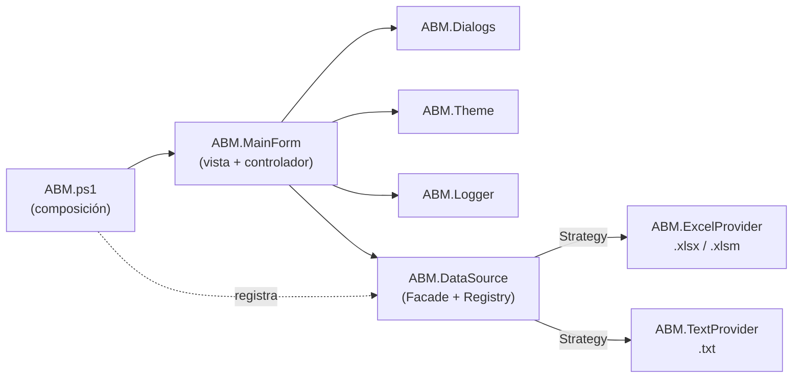

# ABM de Datos · Excel & TXT

Aplicación de escritorio en **PowerShell** para dar de **A**lta, **B**aja y **M**odificar registros en libros de Excel (`.xlsx` / `.xlsm`) y archivos de texto (`.txt`), con una interfaz de estilo ejecutivo.

Está pensada para **entornos corporativos donde no se puede instalar nada**: usa solo lo que Windows ya trae.


---

## ✨ Características

**100 % nativo**
- Windows PowerShell 5.1 + .NET Framework (WinForms, System.Data, System.IO.Compression).
- **No necesita Excel instalado**: lee y escribe el formato OpenXML (ZIP + XML) directamente.
- No instala módulos, no genera `.exe`, no usa `.bat` ni compila código C#.

**Excel (`.xlsx` / `.xlsm`)**
- Detecta automáticamente la fila de encabezados, aunque haya títulos o subtítulos arriba.
- Al guardar **conserva** los estilos de cada columna, las filas de título, los anchos, los paneles inmovilizados, el autofiltro, las tablas de Excel y el resto de las hojas.
- Reconoce fechas, números, booleanos (`VERDADERO` / `FALSO`) y textos con formato.
- Respeta los códigos con ceros a la izquierda (`007` sigue siendo texto).
- Selector de hoja para libros con varias hojas.

**Texto (`.txt`)**
- Detecta automáticamente el delimitador: `;`, tabulación, `|` o `,`.
- Detecta la codificación (UTF-8 con o sin BOM, UTF-16 o ANSI) y la mantiene al guardar.
- Soporta campos entre comillas con delimitadores o comillas dentro (`"Tornillo; largo"`).
- Si no hay delimitador, trabaja en **modo texto plano**: cada línea es un registro.

**Interfaz**
- Encabezado corporativo, tarjetas de indicadores (registros, columnas, origen y estado) y grilla con filas alternadas.
- Búsqueda instantánea sobre todas las columnas y ordenamiento por columna.
- Arrastrar y soltar archivos sobre la ventana.
- **Nuevo archivo**: creás un Excel o un TXT definiendo sus columnas.
- **Guardar como**: convierte de Excel a TXT y viceversa.
- Aviso de cambios sin guardar al cerrar, cambiar de hoja o abrir otro archivo.

**Trazabilidad**
- Auditoría de cada operación (abrir, alta, baja, modificación, guardar) en `Logs\auditoria_yyyyMM.txt`, con fecha, hora y usuario de Windows.
- Respaldo automático del archivo antes de cada guardado en `Backups\`, con rotación configurable.

---

## 🚀 Uso

```powershell
git clone https://github.com/Brunitoa10/lector_excel.git
cd lector_excel

.\ABM.ps1                              # abre la aplicación vacía
.\ABM.ps1 -Path .\inventario.xlsx      # abre directamente un archivo
```

Si la política de ejecución bloquea el script, desbloqueá los archivos descargados:

```powershell
Get-ChildItem -Recurse | Unblock-File
```

### Requisitos

| Requisito        | Versión                              |
|------------------|--------------------------------------|
| Sistema operativo | Windows 10 / 11                     |
| PowerShell       | Windows PowerShell 5.1 (viene con Windows) |
| .NET Framework   | 4.5 o superior (viene con Windows)    |
| Microsoft Excel  | **No requerido**                      |

---

## ⌨️ Atajos de teclado

| Atajo            | Acción                                  |
|------------------|-----------------------------------------|
| `Ctrl + O`       | Abrir archivo                           |
| `Ctrl + N`       | Alta de registro                        |
| `F2` / doble clic | Modificar el registro seleccionado     |
| `Supr`           | Baja de los registros seleccionados     |
| `Ctrl + S`       | Guardar                                 |
| `Ctrl + Shift + S` | Guardar como (Excel o TXT)            |
| `Ctrl + F`       | Ir a la búsqueda                        |
| `Esc`            | Limpiar la búsqueda                     |
| `F5`             | Recargar el archivo desde el disco      |

---

## ⚙️ Configuración

El archivo `config.json` es opcional; si falta o tiene errores, se usan los valores por defecto.

```json
{
  "Auditoria": true,
  "Backup": true,
  "MaxBackupsPorArchivo": 10,
  "CarpetaLogs": "Logs",
  "CarpetaBackups": "Backups",
  "DelimitadorTxtPorDefecto": ";"
}
```

| Clave                      | Descripción                                                          |
|----------------------------|----------------------------------------------------------------------|
| `Auditoria`                | Registra cada operación en `Logs\auditoria_yyyyMM.txt`.              |
| `Backup`                   | Copia el archivo a `Backups\` antes de sobrescribirlo.               |
| `MaxBackupsPorArchivo`     | Cantidad de respaldos que se conservan por archivo.                 |
| `CarpetaLogs` / `CarpetaBackups` | Carpetas relativas a la ubicación de `ABM.ps1`.                |
| `DelimitadorTxtPorDefecto` | Delimitador para TXT nuevos: `;`, `\|`, `,` o `tab`.                 |

Ejemplo de línea de auditoría:

```
2026-11-04 10:15:42 | MODIFICACION | bparisi         | inventario.xlsx [Equipos] | Sector: 'Planta' → 'Sistemas'
```

---

## 🏗️ Arquitectura

El proyecto está modularizado en archivos `.psm1` con una única responsabilidad cada uno, y aplica principios **SOLID** y patrones de diseño.

```
lector_excel/
├── ABM.ps1                     # Punto de entrada y composición (registro de proveedores)
├── config.json                 # Configuración opcional
└── Modules/
    ├── ABM.Config.psm1         # Carga de configuración con valores por defecto
    ├── ABM.Logger.psm1         # Auditoría en .txt y respaldos con rotación
    ├── ABM.DataSource.psm1     # Fachada de datos + registro de estrategias
    ├── ABM.ExcelProvider.psm1  # Estrategia Excel (OpenXML nativo)
    ├── ABM.TextProvider.psm1   # Estrategia TXT (delimitadores, comillas, codificación)
    ├── ABM.Theme.psm1          # Paleta, tipografías, escala DPI y componentes visuales
    ├── ABM.Dialogs.psm1        # Diálogos modales (alta/modificación, nuevo archivo, mensajes)
    └── ABM.MainForm.psm1       # Pantalla principal: vista + controlador de acciones
```



### Patrones y principios aplicados

| Patrón / principio | Dónde se aplica |
|--------------------|-----------------|
| **Strategy**       | Cada formato de archivo implementa `Read`, `Save` y `Create`. |
| **Registry**       | `Register-AbmProvider` asocia extensiones con estrategias. |
| **Facade**         | `Open-AbmSource`, `Save-AbmSource` y `New-AbmSource`: la UI no conoce OpenXML ni delimitadores. |
| **Composition Root** | `ABM.ps1` es el único lugar donde se conectan las piezas. |
| **Template Method** | Todos los diálogos comparten el mismo armazón (`New-AbmDialogShell`). |
| **Single Responsibility** | Un módulo por responsabilidad: configuración, logging, datos, formato, tema, diálogos, pantalla. |
| **Open/Closed**    | Para soportar un formato nuevo alcanza con registrar otro proveedor, sin tocar la UI. |
| **Dependency Inversion** | La pantalla depende de la fachada, no de las implementaciones concretas. |

### Agregar un formato nuevo

```powershell
Register-AbmProvider -Kind 'Csv' -Description 'Valores separados por comas' -Extensions '.csv' `
    -Read   { param($FilePath, $Sheet)           <# devolver @{ Table = <DataTable>; Meta = @{...} } #> } `
    -Save   { param($Source, $Table)             <# sobrescribir $Source.Path #> } `
    -Create { param($FilePath, $Table, $Options) <# crear un archivo nuevo #> }
```

---

## ⚠️ Limitaciones conocidas

- Las **fórmulas** que estén dentro del rango de la tabla editada se guardan como su valor calculado. Las fórmulas fuera de la tabla y en otras hojas no se modifican.
- No soporta el formato binario antiguo `.xls` (Excel 97-2003). Se puede abrir en Excel y guardarlo como `.xlsx`.
- Las celdas combinadas dentro de la tabla no se recalculan al agregar o quitar filas.
- Las filas completamente vacías dentro de la tabla se omiten al leer.

---

## 🛡️ Seguridad

- El código es PowerShell legible, sin ofuscar y sin comandos codificados.
- No usa `Invoke-Expression`, no accede a la red ni al registro y no lanza procesos externos.
- Solo escribe el archivo que se edita y sus carpetas `Logs\` y `Backups\`.

En equipos corporativos se recomienda que el área de Seguridad revise o firme el script antes de usarlo.

---

## 📄 Licencia

Distribuido bajo la licencia **MIT**. Ver [`LICENSE`](LICENSE).

---

## 👤 Autor

**Bruno Ariel Parisi** · Bahía Blanca, Argentina

[](https://github.com/Brunitoa10)
